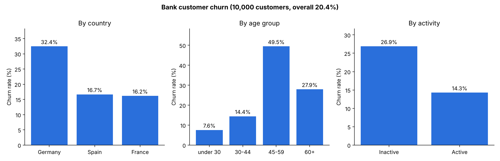

# AI SQL Analyst: Bank Customer Churn Analysis and AI SQL Accuracy Test

A small data project on a bank customer dataset. I analysed churn with SQL
(DuckDB) and then measured how accurately an AI assistant can write SQL for
business questions about the same data.



## What this project does

1. Loads 10,000 bank customers (3 countries) into a DuckDB database.
2. Answers business questions with SQL (churn by country, age group, balance, activity).
3. Builds a "golden set" of 10 questions with verified correct SQL.
4. Asks an AI assistant to write SQL for the same 10 questions and scores
   its answers automatically against the golden set.

## Tools

Python, DuckDB, pandas, SQL, Streamlit, Plotly, Git/GitHub, uv

## Key findings

- Overall, 2,038 of 10,000 customers left the bank (about 20.4%).
- Germany has the highest churn rate (32.44%) and the highest average balance (119,730).
- In France and Spain, customers who left had about 18-22% higher average
  balances than those who stayed. In Germany the two groups are almost
  identical (about 0.8% apart), so balance alone does not explain Germany's churn.
- Inactive members churn at 26.87% versus 14.27% for active members.
- Card type makes little difference (19-22% churn across card types).
- 2,034 of the 2,044 customers who complained left. This looks like data
  leakage (the complaint is probably recorded at or after exit), so it
  should not be used to predict churn.

These are averages and patterns, not proven causes.

## AI SQL accuracy test

- Golden set: 10 questions with SQL I wrote and checked by hand (`golden_set.py`).
- The AI assistant (a general-purpose chat assistant) was given only the table
  schema and the questions, and returned SQL (`ai_answers_v1.sql`).
- `score.py` runs both queries and compares the result tables.

**Result (first attempt): 8 out of 10 correct (80%).** See `results_v1.txt`.

The two misses were Q5 and Q9. In both cases the AI's numbers were right
but the result shape differed from my golden query, because my questions
were ambiguous: Q5 ("top 5 customers by balance") returned all columns
instead of two, and Q9 returned one row instead of a split by `Complain`.
The scoring is strict, so these count as wrong. I kept the first score
as it is.

The first test (8/10) was done manually in a chat window (no API key was used).
The repo now also includes `run_ai_test.py`, which calls the Gemini API and scores
the answers automatically (see below). Its results are not part of the 8/10 above.

## Safety check for AI-written SQL

Before any AI-generated query is run, `sql_guard.py`:

- accepts only a single `SELECT` statement (blocks `DROP`, `DELETE`, `UPDATE`, `COPY`, multiple statements)
- scans for write/admin keywords (this also catches a `DELETE` hidden inside a `WITH`)
- runs it on a read-only database connection with file/network access switched off

Tests: `uv run python -m pytest`

## How to run

```bash
uv sync
# download the "Bank Customer Churn" CSV (Customer-Churn-Records.csv) from Kaggle
# into a folder named data/
uv run build_db.py       # creates bank.db
uv run queries.py        # prints the analysis queries
uv run golden_set.py     # prints the 10 verified answers
uv run make_prompt.py    # creates the prompt to give to an AI assistant
# save the AI's SQL in ai_answers.sql, then:
uv run score.py          # prints CORRECT / WRONG per question and the score
uv run build_summary.py  # creates the summary/*.csv files used by the dashboard
uv run streamlit run app.py   # opens the dashboard in your browser
```

Fully automated AI test (needs a Gemini API key in a local `.env`: `GEMINI_API_KEY=...`):

```bash
uv run make_prompt.py
uv run run_ai_test.py    # asks Gemini, saves its SQL, prints the score
```

Optional: set `GEMINI_MODEL` in `.env` to choose the model.

## Files

| File | Purpose |
|---|---|
| `build_db.py` | Loads the CSV into DuckDB |
| `queries.py` | SQL analysis queries |
| `insights.md` | Findings written in plain language |
| `golden_set.py` | 10 questions with verified correct SQL |
| `make_prompt.py` | Builds the prompt for the AI assistant |
| `ai_answers_v1.sql` | The AI's SQL from the first test |
| `score.py` | Compares AI results with the golden set (`uv run score.py [file.sql]`) |
| `scoring.py` | Shared scoring logic |
| `sql_guard.py` | SELECT-only safety check and read-only connection |
| `run_ai_test.py` | Calls the Gemini API and scores the answers automatically |
| `tests/` | Unit tests for the safety check |
| `results_v1.txt` | Output of the first test (8/10) |
| `build_summary.py` | Exports summary tables to `summary/` |
| `app.py` | Streamlit dashboard of the churn findings |
| `summary/` | Aggregated results (no customer-level data) |
| `docs/churn_overview.png` | Chart used in this README |

## What I would improve next

- Run `run_ai_test.py` with a real API key and report that score separately.
- Rewrite the two ambiguous questions and report a second score separately.

## Author

Yogesh Shinde, BBA (Computer Applications), Pune